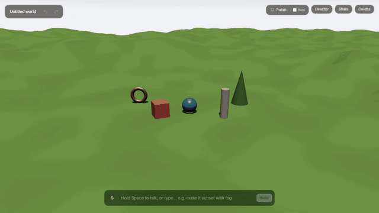
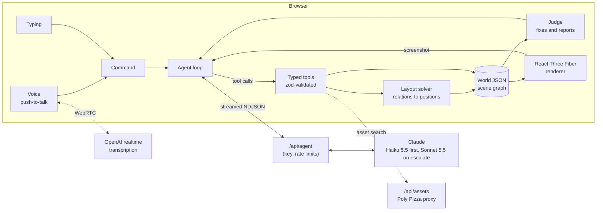

# Speakworld

**Talk, and a 3D world builds itself.** Hold Space and say "a cosy village by a lake at sunset", and Claude builds it in front of you: terrain, water, houses, lamps and flowers, placed sensibly and lit for the time of day. Then say "slowly fly over the village", and record the shot as a vertical video for reels.



_Real run, 1.5x speed. Commands are typed here; holding Space and speaking runs the same way._

## What it does

- **Build by voice or text.** "Put a bench there" (click the ground first), "make this bigger", "remove all the trees", "make it a winter wonderland".
- **Real models.** It uses a bundled Kenney kit (CC0) first, then searches Poly Pizza for anything else, with attribution in Credits. Forests, rocks, grass and flowers are procedural and instanced, so hundreds of trees stay fast.
- **Sensible layout.** Claude describes _relations_ ("near the lake, facing the well"), never coordinates. A deterministic solver turns them into positions on the terrain, out of the water and off the paths.
- **It checks its own work.** After every command a judge fixes floating, buried, overlapping or drowned objects. **Polish** sends Claude a screenshot to critique and fix.
- **Recipes.** "Save this as my camp", then "add my camp by the river". There are five built-in recipes: spooky, cosy village, tropical island, winter wonderland and alien planet.
- **Director mode.** Flyover, orbit, reveal and push-in shots, recorded as 1080x1920 MP4 for reels.
- **Share and export.**
  - Share a read-only link (the world travels inside the link, so no database is needed).
  - Export GLB (standard glTF, for Blender and other tools) or JSON.
  - Undo and redo everything; a whole command is one undo step.

## How it works



1. **The scene graph is the source of truth.** A world is plain JSON (`src/scene/schema.ts`, one zod schema that also generates Claude's tool schemas). Rendering is a pure function of it. Every change is an Immer patch, so undo, redo and rolling back a cancelled command are cheap.
2. **Claude only ever calls typed tools**, such as `set_environment`, `add_objects`, `add_procedural`, `update_objects`, `create_region`, `apply_macro`, `capture_view`, `set_camera` and `say`. Each input is validated before it runs; errors go back to Claude as tool results, and it corrects itself.
3. **The loop runs in the browser.** The server route only holds the API key, adds the cached system prompt and tools, rate-limits, and streams events back. Each tool runs the moment its block finishes streaming, and partial tool input already shows ghost placeholders and starts the sky changing. Across eval runs, the median time to the first visible change is 1.2 to 1.5 s.
4. **Haiku first, Sonnet when it matters.** Haiku 5.5 handles most commands. For multi-part compositions or whole-scene restyles it calls `escalate`, the turn rolls back, and Sonnet 5.5 reruns it. In the evals this escalated exactly the hard cases and halved the cost.
5. **Coordinates come from a solver, not the model.** `src/layout/solver.ts` is pure and seeded. It scores candidate spots against every relation and penalises overlap (spatial hash), water, paths and leaving the world. It snaps to the same height field the terrain mesh uses.
6. **A judge closes the loop.** It checks only what this command touched, fixes positions itself within the same undo step, and sends anything it can't fix back to Claude once.

## Evals

`pnpm evals` runs 15 real commands against Claude, with the exact request the app sends. Each case checks the resulting world declaratively ("a cabin within 20 m of the lake, and nothing in the water"). CI fails below an 85% pass rate.

| Run                          | Pass  | First change visible (p50) | Whole command (p50) | Cost per run |
| ---------------------------- | ----- | -------------------------- | ------------------- | ------------ |
| Haiku first, Sonnet escalate | 15/15 | 1.5 s                      | 1.7 s               | $0.023       |

## Running it

Requires Node 22+ and pnpm.

```bash
pnpm install
cp .env.example .env.local   # then add your keys
pnpm dev                     # http://localhost:3000
```

| Variable                                                | Needed for                                                                                       |
| ------------------------------------------------------- | ------------------------------------------------------------------------------------------------ |
| `ANTHROPIC_API_KEY`                                     | The agent (required)                                                                             |
| `POLYPIZZA_API_KEY`                                     | Online models (without it, unknown objects are simple shapes)                                    |
| `OPENAI_API_KEY`                                        | Streaming speech-to-text (without it, the browser's speech recognition is used)                  |
| `AGENT_DAILY_LIMIT_PER_IP`, `AGENT_HOURLY_LIMIT`        | Spend protection on a public deployment (defaults 300 and 2000 requests)                         |
| `AGENT_DISABLED`                                        | Set to `1` to switch the agent off                                                               |
| `NEXT_PUBLIC_SUPABASE_URL`, `SUPABASE_SERVICE_ROLE_KEY` | Optional: short `/w/<id>` share links with preview images, instead of links that carry the world |

All keys are read only by server routes; the browser never sees them.

```bash
pnpm typecheck && pnpm lint && pnpm test   # unit tests
pnpm build && pnpm test:e2e                # Playwright smoke test (Claude mocked)
pnpm evals                                 # real Claude, a few cents
```

## Deploying

The app deploys to Vercel as a normal Next.js project; add the environment variables above in the project settings. Spend is protected in layers:

- 30 requests a minute and 300 a day per visitor.
- An hourly cap across everyone each server instance serves.
- Request size limits, and only known model profiles accepted.
- `AGENT_DISABLED` as an off switch.

Also set a monthly spend limit in the Anthropic console.

## Tech

Next.js 16 (App Router), React 19, three.js with React Three Fiber and drei, zustand and Immer, zod 4, the Anthropic TypeScript SDK, Tailwind 4, Vitest and Playwright.

## Credits

- 3D models: [Kenney](https://kenney.nl) Nature, Holiday and Survival kits (CC0), and [Poly Pizza](https://poly.pizza) models listed in the in-app Credits panel with their licences.
- Built with [Claude Code](https://claude.com/claude-code).
